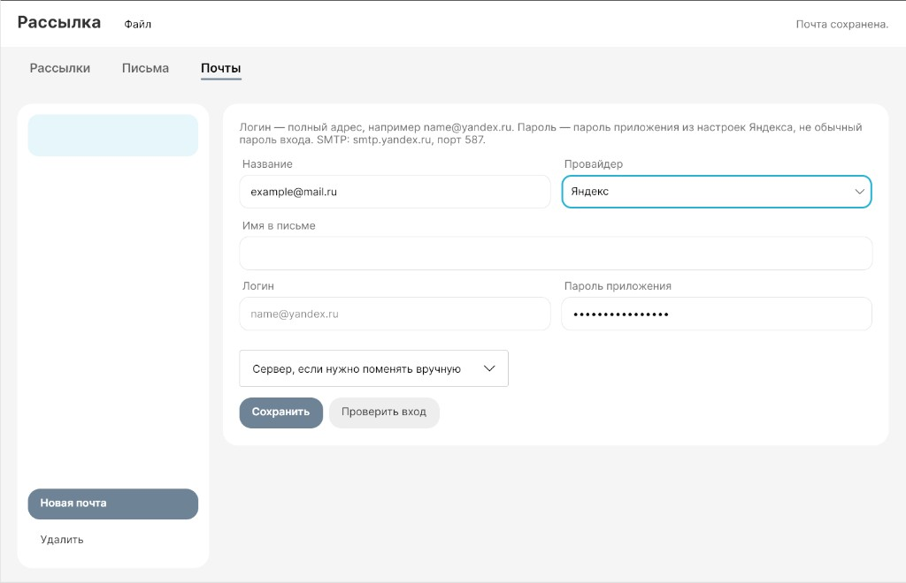

# Рассылка

Программа для автоматической почтовой рассылки. Тема письма любая: приглашение, уведомление, рассылка по списку — программа к подкасту не привязана. Несколько ящиков, шаблоны и очереди адресов живут в одном окне. Письма уходят по одному с паузой, чтобы не долбить сервер.

.NET на компьютер ставить не нужно: в папках `linux/` и `windows/` уже готовые сборки. В этом репозитории **нет** чужих почт и очередей. Свой список появится у вас в файле `app.db` после первого запуска.



## Важно: ящик могут заблокировать

Рассылка через SMTP — это не кнопка «написать» на сайте почты. Провайдер видит поток одинаковых писем с одного ящика. Яндекс, Mail.ru и Google могут:

- отправить письма получателям в спам;
- временно запретить отправку;
- заблокировать ящик, если решат, что это реклама или шаблонная массовая рассылка.

Пауза (по умолчанию час) снижает риск, но **не защищает**. Личные ящики для массовой коммерческой рассылки режут чаще рабочих. Один шаблон на сотни адресов — типичный триггер фильтров.

Программа не обходит лимиты и не прячет рассылку. Суточный потолок SMTP у Яндекса порядка 300 писем; час паузы — это до 24 писем в сутки с одного ящика. Если ящик дорог — не гоните с него поток.

## Пока идёт рассылка

Письмо уходит только пока программа запущена и компьютер не спит.

- **Не выключайте компьютер** и не уводите его в сон или гибернацию.
- **Не завершайте программу** через диспетчер задач и не выгружайте её из трея.
- Крестик окна **не останавливает** рассылку: программа уходит в трей и продолжает слать. Это нормально.
- Остановить отправку — кнопка **«Остановить»** у рассылки.
- Выйти совсем — **Файл → Выход**. Тогда цикл прекращается. Уже отправленные адреса остаются отправленными, очередь не сбрасывается.

Пропущенные часы, пока ПК был выключен, программа **не догоняет пачкой**. После следующего «Начать» первое письмо уходит сразу, дальше снова пауза.

На Windows на время рассылки сон обычно блокируется, но крышка ноутбука и принудительное выключение всё равно обрывают работу.

## Что внутри

Три вкладки. Работать лучше в **окне** — это основной режим.

**Почты** — откуда слать. Яндекс, Mail.ru, Gmail или свой SMTP. Логин — полный адрес. Пароль — **пароль приложения**, не пароль от входа на сайт. «Проверить вход» только стучится на сервер, письмо никуда не уходит. Сервер и порт обычно подставляются сами.

**Письма** — что слать. Название, тема, необязательное описание для списка слева и текст. Жирный и курсив: выделите фрагмент и нажмите кнопку. Ссылка `https://…` становится ссылкой сама. Превью внизу — **текст письма**, не описание. Можно импортировать `.docx` кнопкой «Письмо из Word».

**Рассылки** — процесс. Почта + письмо + пауза в минутах. Адреса: вставить скопом, загрузить Excel `.xlsx` или править список. Есть поиск. «Начать» / «Остановить». Полоска и таймер показывают, сколько уже ушло и когда следующее письмо.

Слева **очередь** (следующий адрес сверху; если рассылка идёт — справа время отправки). Справа **отправлено** (свежие сверху).

Несколько рассылок могут идти сразу. Две рассылки с **одной** почты всё равно делят этот ящик: письма не улетают одновременно. Один адрес в **разных** рассылках допустим. Внутри одной рассылки повтор не уходит.

Данные — файл `app.db` рядом с программой. Postgres и Docker не нужны.

Ошибка SMTP (сеть, VPN, пароль) всплывает окном с текстом. Часто Яндекс не открывается из VPN: исключите `smtp.yandex.ru` из туннеля.

## Windows

1. Папка `windows`.
2. `start.bat` или `PodcastInvite.exe`.
3. .NET ставить не нужно.

Автозапуск после входа: `Win+R` → `shell:startup` → ярлык на `start.bat`. После загрузки всё равно нажмите «Начать». Пока ПК выключен или спит, очередь стоит.

Импорт очереди из старого файла `mailer.db`: откройте рассылку → кнопка импорта на карточке рассылки. Копия базы: **Файл → Экспорт копии базы**.

## Linux

Нужен рабочий стол со экраном.

```bash
cd linux
chmod +x start.sh PodcastInvite
./start.sh
```

Можно `./PodcastInvite` из той же папки. Файлы читаются **из папки программы**. `linux/` и `windows/` — две разные копии данных. Docker для окна не нужен.

## Обновление

Git на компьютер ставить не нужно.

**Файл → Проверить обновление.** Если вышла новая версия, программа скачает её с GitHub Release и попросит перезапуск. Файл `app.db` (почты, письма, очередь) не затирается.

Чтобы обновление находило файл, на странице Releases должны висеть zip с **точными** именами:

- `email-sendler-windows.zip`
- `email-sendler-linux.zip`

## Как пользоваться

1. **Почты** — добавить ящик, сохранить, при желании проверить вход.
2. **Письма** — написать или взять из Word, сохранить.
3. **Рассылки** — создать, выбрать почту и письмо, задать паузу, сохранить.
4. Вставить адреса или Excel.
5. **Начать**. Дальше не выключать ПК и не убивать процесс. Окно можно свернуть в трей.

Удаление почты, письма, рассылки и адреса спрашивает подтверждение.

## Два режима

| Режим | Как | Когда |
|--------|-----|--------|
| Окно (рекомендуется) | Запуск без аргументов, `start.bat` / `start.sh` | Обычная работа |
| Консоль | `PodcastInvite --cli` (Linux) или `PodcastInvite.exe --cli` (из cmd) | Старый режим: файлы `config.txt`, `letter.docx`, `emails.xlsx` рядом с программой |

Консольный режим сохранился, но его незачем включать, если есть окно. В окне те же отправки, плюс несколько ящиков и рассылок без ручных файлов.

## Почтовики

| Провайдер | SMTP | Порт |
|-----------|------|--------|
| Яндекс | smtp.yandex.ru | 587 |
| Mail.ru | smtp.mail.ru | 465 |
| Gmail | smtp.gmail.com | 587 |

Gmail — SMTP и пароль приложения, без входа через Google и без Gmail API.

SMTP у Яндекса **не копирует** письмо в «Отправленные». Смотрите очередь в программе, `send.log` и входящие (в том числе спам) у получателя.

## Файлы рядом с программой

| Файл | Зачем |
|------|--------|
| `app.db` | Почты, письма, рассылки, очередь. Появляется после запуска. Это ваши данные, в git их нет |
| `send.log` | Журнал отправок |
| `letter.docx`, `config.txt`, `mailer.db` | Могут остаться от консольного режима. При первом запуске окна ящик и письмо из них подхватываются. Очередь из `mailer.db` — только через «Импорт» |
